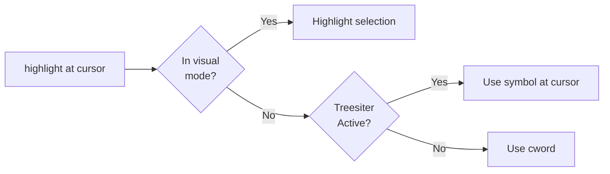

# confetti

Highlight lots of words like it's a party

## Features

- 🎨 Highlight words with colorful backgrounds
- 🌳 Smart highlighting using treesitter when available
- 📝 Fallback to regex-based word matching
- 🎯 Visual mode support
- 🔧 Customizable color schemes
- 👁️ Built-in highlight group viewer
- 🪟 Multi-pane support - highlights appear in all visible windows
- 🔇 Configurable logging levels for less verbose output

## API

```lua
local confetti = require("confetti")

-- Setup with default or custom colors
confetti.setup({
  colors = { ... },         -- Optional: custom color definitions
  reused_hlgroups = {},     -- Optional: use existing highlight groups
  log_level = vim.log.levels.WARN  -- Optional: logging verbosity (default: WARN)
})

-- Available log levels:
-- vim.log.levels.DEBUG  - Show all debug messages
-- vim.log.levels.INFO   - Show info and above
-- vim.log.levels.WARN   - Show warnings and errors (default)
-- vim.log.levels.ERROR  - Show only errors
-- vim.log.levels.OFF    - No logging

-- Highlight word at cursor
confetti.highlight_at_cursor()

-- Clear all highlights
confetti.clear_highlights()

-- Show all highlight groups (prints to console)
confetti.show_highlights()

-- Open a visual buffer showing all highlight groups
confetti.test_highlights()

-- Reload the plugin (for development)
confetti.reload()
```

## Configuration Examples

### Minimal setup (uses defaults)
```lua
require("confetti").setup()
```

### Quiet mode (no debug messages)
```lua
require("confetti").setup({
  log_level = vim.log.levels.ERROR  -- Only show errors
})
```

### Debug mode (show all messages)
```lua
require("confetti").setup({
  log_level = vim.log.levels.DEBUG  -- Show all debug info
})
```

### Custom colors
```lua
require("confetti").setup({
  colors = {
    { guifg = "black", guibg = "red" },
    { guifg = "white", guibg = "blue" },
    { guifg = "black", guibg = "yellow", bold = true },
  }
})
```

# Installation

## lazy.nvim
```lua
return {
  {
    "imochoa/confetti.nvim",
    -- lazy = true,
    opts = {
      reused_hlgroups = {},
      colors = {},
      log_level = vim.log.levels.WARN,  -- Optional: control logging verbosity
    },
    keys = {
      { "<leader>*", "", desc = "+Confetti!", mode = { "n", "v" } },
      {
        "<leader>**",
        function()
          require("confetti").highlight_at_cursor()
        end,
        mode = { "n", "v" },
        desc = "confetti highlight at cursor",
      },
      {
        "<leader>*d",
        function()
          require("confetti").clear_highlights()
        end,
        desc = "clear confetti highlights",
      },
      {
        "<leader>*s",
        function()
          require("confetti").show_highlights()
        end,
        desc = "show confetti highlight groups",
      },
      {
        "<leader>*t",
        function()
          require("confetti").test_highlights()
        end,
        desc = "test confetti highlights (visual)",
      },
    },
  },
{
    "folke/which-key.nvim",
    optional = true,
    opts = {
      spec = {
        { "<leader>*", group = "confetti" ,icon = "🎉"},
      },
    },
  }
}

```
## Using LazyVim


```lua
-- ~/.config/nvim/lua/plugins/confetti.lua
return {
 {
  "imochoa/confetti.nvim",
  opts = {
   reused_hlgroups = {},
   colors = {
    {
     guifg = "black",
     guibg = "white",
     altfont = false,
     bold = false,
     inverse = false, -- Inverse will flip fg and bg
     italic = false,
     nocombine = false,
     standout = false,
     strikethrough = false,
     undercurl = false,
     underdashed = false,
     underdotted = false,
     underdouble = false,
     underline = false,
    },
    { guifg = "black", guibg = "magenta", altfont = true },
    { guifg = "black", guibg = "lime", bold = true },
    { guifg = "black", guibg = "yellow", italic = true },
    { guifg = "black", guibg = "red", nocombine = true },
    { guifg = "black", guibg = "darkviolet", standout = true },
    { guifg = "black", guibg = "chocolate", strikethrough = true },
    { guifg = "black", guibg = "thistle", undercurl = true },
    { guifg = "black", guibg = "orangered", underdashed = true },
    { guifg = "black", guibg = "greenyellow", underdotted = true },
    { guifg = "black", guibg = "aqua", underdouble = true },
    { guifg = "black", guibg = "hotpink", underline = true },
   },
  },
  keys = {
   {
    "<leader>*",
    function()
     require("confetti").highlight_at_cursor()
    end,
    desc = "Highlight at cursor",
   },
   {
    "<leader>**",
    function()
     require("confetti").clear_highlights()
    end,
    desc = "Clear all confetti highlights",
   },
  },
 },
}
```

## Logic



# Development

## Prerequisites

- Neovim 0.11 or newer (the plugin uses `vim.hl.range`)
- [just](https://github.com/casey/just)
- [pre-commit](https://pre-commit.com/) (runs stylua and the other hooks)

## Setup

Clone the test dependencies (mini.nvim, which provides `mini.test` and `mini.doc`) into `deps/`:

```bash
just setup
```

Run the tests:

```bash
just test-all
just test-file ./tests/test_logging.lua
```

## Local Development Setup

To work on the plugin locally and test your changes:

### 1. Clone the repository

```bash
git clone https://github.com/imochoa/confetti.nvim.git ~/code/confetti.nvim
cd ~/code/confetti.nvim
```

### 2. Configure Neovim to use your local copy

Update your Neovim configuration to point to your local clone instead of the GitHub repository.

#### Using lazy.nvim

```lua
-- ~/.config/nvim/lua/plugins/confetti.lua
return {
 {
  -- Use local directory instead of GitHub
  dir = "~/code/confetti.nvim",
  opts = {
   -- Your configuration here
  },
  keys = {
   {
    "<leader>*",
    function()
     require("confetti").highlight_at_cursor()
    end,
    desc = "Highlight at cursor",
   },
   {
    "<leader>**",
    function()
     require("confetti").clear_highlights()
    end,
    desc = "Clear all confetti highlights",
   },
  },
 },
}
```

#### Using packer.nvim

```lua
use {
 "~/code/confetti.nvim",
 config = function()
  require("confetti").setup({
   -- Your configuration here
  })
 end
}
```

### 3. Reload the plugin during development

The plugin includes a reload function for development. Add a keybinding to quickly reload changes:

```lua
vim.keymap.set("n", "<leader>cr", function()
 require("confetti").reload()
end, { desc = "Reload confetti plugin" })
```

Now you can:

1. Make changes to the plugin code
2. Press `<leader>cr` to reload the plugin
3. Test your changes immediately without restarting Neovim

```lua
vim.keymap.set("n", "<space><space>x", "<cmd>source %<CR>")
vim.keymap.set("n", "<space>x", ":.lua<CR>")
vim.keymap.set("v", "<space>x", ":lua<CR>")
```

## Tools Configuration

- **StyLua**: Configured in `.stylua.toml`, run through `.pre-commit-config.yaml`
- **Testing**: Uses [mini.test](https://github.com/nvim-mini/mini.nvim/blob/main/readmes/mini-test.md); tests live in `tests/test_*.lua`
- **Docs**: `just docs` regenerates `doc/` with mini.doc

# Lua

## Annotations

<https://luals.github.io/wiki/annotations/>
